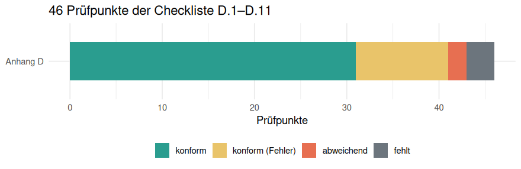
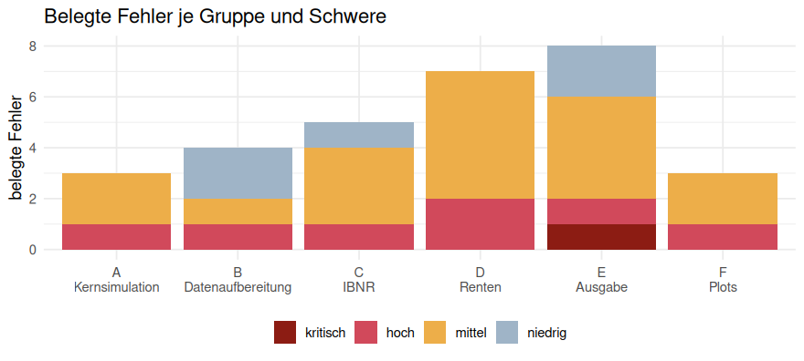
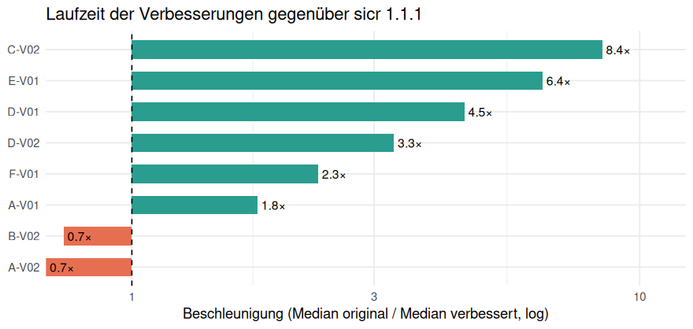

Prüfbericht: R-Paket sicr 1.1.1
================

- [Kurzfassung](#kurzfassung)
- [Gegenstand und Vorgehen](#gegenstand-und-vorgehen)
- [Paperkonformität](#paperkonformität)
- [Fehler](#fehler)
- [Verbesserungen](#verbesserungen)
- [Codequalität](#codequalität)
- [Grenzen der Prüfung](#grenzen-der-prüfung)
- [Reproduktion](#reproduktion)

## Kurzfassung

Geprüft wurde das R-Paket [sicr](https://github.com/dskowasch/sicr) von
Dirk Skowasch in Version 1.1.1 (Commit `c0ad2ad`), und zwar alle 83
Funktionen. Maßstab war der DAV-Ergebnisbericht [„Stochastische
Einzelschadenreservierung“ vom
04.02.2025](https://aktuar.de/content/PDF/Fachwissen/2025-02-04_DAV_SV_EB_Stochastische_Einzelschadenreservierung.pdf).
Gerechnet wurde ausschließlich in R 4.4.2.

- **Paperkonformität:** Das Verfahren ist im Kern so umgesetzt, wie der
  Bericht es beschreibt: Ziehung aus Pools je Abwicklungsjahr und
  Reserveklasse, linearer Nachlauf, additives Spätschadenmodell, Renten
  mit zufälligem Sterbejahr, Rückversicherung je Pfad. Von den 46
  Prüfpunkten aus Anhang D sind 31 konform, 10 konform, aber durch einen
  belegten Fehler beeinträchtigt, 2 methodisch abweichend und 3 fehlen
  (vor allem das Ultimate-Backtesting).
- **Fehler:** 30 Fehler sind mit je einem testthat-Test belegt, davon 1
  kritisch und 7 hoch. Die wichtigsten: In den aggregierten
  Großschadendreiecken fehlt der XL-Anteil der Spätgroßschäden (E-F01).
  Mehrere Funktionen ordnen Daten nach Zeilenposition statt nach Jahr zu
  und rechnen bei unsortierter Eingabe ohne Meldung falsch (B-F01,
  C-F03, D-F03, E-F02). Das Backtesting vergleicht nominale Prognosen
  mit deflationierten Ist-Werten (F-F01).
- **Verbesserungen:** 12 Vorschläge liegen als lauffähiger Code vor,
  jeweils mit Gleichheitstest gegen das Original. Die
  Effizienzvorschläge wurden gemessen, zwei davon sind langsamer und nur
  noch als Lesbarkeitsgewinn geführt.
- **Belege:** 76 Tests, davon 76 bestanden. Ein grüner Fehlertest heißt:
  Der Fehler besteht in sicr 1.1.1.

## Gegenstand und Vorgehen

| Gruppe                       | Funktionen | Fehler | Verbesserungen | Analyse                                                               |
|:-----------------------------|-----------:|-------:|---------------:|:----------------------------------------------------------------------|
| A: Kernsimulation            |          6 |      3 |              2 | [A_kernsimulation.md](../analyse/A_kernsimulation.md)                 |
| B: Datenaufbereitung         |         28 |      4 |              2 | [B_datenaufbereitung.md](../analyse/B_datenaufbereitung.md)           |
| C: IBNR, Sonderschäden, RV   |         10 |      5 |              2 | [C_ibnr_sonderschaeden_rv.md](../analyse/C_ibnr_sonderschaeden_rv.md) |
| D: Renten, Basisschäden      |         16 |      7 |              2 | [D_renten_basisschaeden.md](../analyse/D_renten_basisschaeden.md)     |
| E: Ausgabe, Eingabeprüfungen |         14 |      8 |              2 | [E_ausgabe_pruefungen.md](../analyse/E_ausgabe_pruefungen.md)         |
| F: Plots, Backtesting        |          9 |      3 |              2 | [F_plots_backtesting.md](../analyse/F_plots_backtesting.md)           |

Die Prüfung war gestaffelt. Die Kernfunktionen (Simulation, Pools,
Nachlauf, IBNR, Renten, Rückversicherung) wurden Zeile für Zeile gegen
den Bericht gelesen. Hilfs-, Plot- und Excel-Funktionen wurden als
Code-Review geprüft. Für jede Funktion gibt es einen Abschnitt in der
Analyse ihrer Gruppe mit Zweck, Paperbezug (Abschnitt und Seite),
Fehlern, Verbesserungen und Hinweisen.

**Beweisstandard.** Ein Fehler zählt nur, wenn ein testthat-Test ihn
zeigt (`befunde/test-<ID>.R`). Der erste Test prüft das fehlerhafte
Verhalten von sicr 1.1.1 und ist grün, solange der Fehler besteht. Gibt
es eine Korrektur, zeigt ein zweiter Test in derselben Datei, dass
`verbesserungen/<ID>.R` richtig rechnet. Ohne Test heißt eine
Beobachtung „Verdacht (unbelegt)“ oder „Hinweis“.

**Gegenprüfung.** Jeder Befund wurde danach mit dem Auftrag
gegengelesen, ihn zu widerlegen ([A–C](../analyse/gegenpruefung_ABC.md),
[D–F](../analyse/gegenpruefung_DEF.md)). Daraufhin wurden sechs
Schweregrade gesenkt (A-F03, B-F02, D-F01, E-F04, E-F06, E-F07), drei
Begründungen berichtigt (D-F03, E-F02, F-F02) und ein Hinweis widerlegt
(F-H04: das Beispiel läuft über partielle Argumentzuordnung). Die
Korrektur zu D-F06 wurde umgebaut, sie liefert jetzt eine Fehlermeldung
statt einer stillen Nullprognose. D-F01 war in der ersten Fassung falsch
begründet und ist neu belegt. Die schweren Befunde hat der Prüfer
zusätzlich selbst am Quellcode nachvollzogen.

**Schwereskala.** *kritisch*: Reserve oder Verteilung im Normalfall
falsch · *hoch*: falsch in realistischen Datenlagen · *mittel*: Randfall
oder Absturz mit Meldung · *niedrig*: Stil, Doku.

## Paperkonformität

<!-- -->

Die vollständige Matrix mit Fundstelle im Code und Begründung je Punkt
steht in [`analyse/paper_abgleich.md`](../analyse/paper_abgleich.md).
Die methodischen Abweichungen und Lücken:

| Punkt                           | Befund                                                                                                              |
|---------------------------------|---------------------------------------------------------------------------------------------------------------------|
| D.6.1 Spätgroßschadenanzahl     | Das letzte beobachtbare Abwicklungsjahr N geht nicht in das additive Modell ein (C-F05).                            |
| D.9.1 Rückversicherungsprogramm | AAD/AAL sind nicht umgesetzt (in sicr dokumentiert). Zusätzlich setzt die Indexklausel ein Jahr zu früh an (C-F04). |
| D.2.2 Großschadenschwelle G     | Es wird nicht geprüft, ob G unter der kleinsten Priorität liegt. Der Bericht empfiehlt das.                         |
| D.10.3 Ultimate-Backtesting     | Fehlt. Vorhanden ist nur das Cashflow-Backtesting des ersten Folgejahres (F-H01).                                   |
| D.11.4 Ergebnisdokumentation    | Pflicht des Anwenders, das Paket bietet keine Ergebnissammlung.                                                     |

Kapitel 3 des Berichts (Anwendungsstudien) lässt sich mangels Daten
nicht nachrechnen. Geprüft wurden dort nur die Definitionen, etwa die
des Backtestings.

## Fehler

<!-- -->

| ID    | Schwere  | Funktion                                                                                    | Befund                                                                                                                                                                                                          | Beleg                           | Korrektur                         |
|:------|:---------|:--------------------------------------------------------------------------------------------|:----------------------------------------------------------------------------------------------------------------------------------------------------------------------------------------------------------------|:--------------------------------|:----------------------------------|
| E-F01 | kritisch | `aggregate_large_claims_results()`                                                          | XL-Anteil der IBNR-Zeilen fehlt in `large_ceded_xl_payments`; Netto zu hoch (S. 55)                                                                                                                             | [Test](../befunde/test-E-F01.R) | [Code](../verbesserungen/E-F01.R) |
| A-F01 | hoch     | `generate_pools()`                                                                          | Ausreißergrenzen werden bei Nachlaufpools nach der Hochskalierung auf $M+1$-Niveau angewandt (Z. 130–139); effektive Grenze um Faktor $(T-M)/(T-k+1)$ zu streng                                                 | [Test](../befunde/test-A-F01.R) | [Code](../verbesserungen/A-F01.R) |
| B-F01 | hoch     | `expand_historic_indices()`                                                                 | Indexwerte werden positionsbasiert statt nach `Calendar_year` zugeordnet; Lücken erzeugen einen kryptischen Fehler                                                                                              | [Test](../befunde/test-B-F01.R) | [Code](../verbesserungen/B-F01.R) |
| C-F03 | hoch     | `get_expected_ibnr_numbers()`                                                               | Stille Sortierannahme an `exposure` (Zeilen 104-118): unsortiert werden IBNR-Anzahlen den falschen Anfalljahren zugeordnet                                                                                      | [Test](../befunde/test-C-F03.R) | [Code](../verbesserungen/C-F03.R) |
| D-F03 | hoch     | `compute_small_claims()`                                                                    | Quota-Share positionsabhängig statt nach Anfalljahr; unsortierte RV-Daten ergeben falsche Quoten                                                                                                                | [Test](../befunde/test-D-F03.R) | [Code](../verbesserungen/D-F03.R) |
| D-F07 | hoch     | `generate_small_claims_annuities_parameters()` / `generate_small_claims_future_annuities()` | Ergebnis der künftigen Basisrenten hängt vom Indexjahr ab (Faktor `I(Anfalljahr)/I(Indexjahr)`)                                                                                                                 | [Test](../befunde/test-D-F07.R) | [Code](../verbesserungen/D-F07.R) |
| E-F02 | hoch     | `aggregate_large_claims_results()`                                                          | Quotenabgabe über Zeilenposition statt `match(Origin_year)`; unsortierte RV-Jahre ergeben falsche Quoten                                                                                                        | [Test](../befunde/test-E-F02.R) | [Code](../verbesserungen/E-F02.R) |
| F-F01 | hoch     | `backtesting_1y_per_reserve_class()`, `backtesting_1y_per_origin_year()`                    | Nominale Erwartung vs. auf das Indexjahr deflationierter Ist-Wert (`Ind_cl_payment_cal`), systematische Verzerrung um den Zukunftsinflationsfaktor (im Beispiel 3 %).                                           | [Test](../befunde/test-F-F01.R) | [Code](../verbesserungen/F-F01.R) |
| A-F02 | mittel   | `generate_pools()`, `pools2matrix()`                                                        | `2:(start_of_tail - 1)` erzeugt für `start_of_tail <= 2` Pretail-Pools für Abwicklungsjahr 1/0 und doppelte Verwendung von Jahr 2 (Z. 73 bzw. Z. 85)                                                            | [Test](../befunde/test-A-F02.R) | [Code](../verbesserungen/A-F02.R) |
| A-F03 | mittel   | `sicr()`                                                                                    | Zukunftsindexierung über `tail(indices$Transition_factor, 250)[year]` setzt `max(indices$Calendar_year) == last_orig_year + 250` voraus (Z. 451); zusätzliche Indexjahre verschieben alle zukünftigen Zahlungen | [Test](../befunde/test-A-F03.R) | [Code](../verbesserungen/A-F03.R) |
| B-F03 | mittel   | `inc2cum()`                                                                                 | Leere Matrix stürzt durch `for (i in 1:0)` ab                                                                                                                                                                   | [Test](../befunde/test-B-F03.R) | [Code](../verbesserungen/B-F03.R) |
| C-F01 | mittel   | `roll_out_single_claim()`                                                                   | Zeile 30 setzt `art` statt `type`; ungültiger `Rollout_type` liefert still einen Null-Cashflow (BE = 0)                                                                                                         | [Test](../befunde/test-C-F01.R) | [Code](../verbesserungen/C-F01.R) |
| C-F04 | mittel   | `generate_xl_indices_per_claim()`                                                           | Indexklausel ein Jahr zu früh verankert (Zeile 76): Faktor im Basisjahr 1+`Index_re` statt 1, Priorität zu hoch, RV-Anteil zu klein                                                                             | [Test](../befunde/test-C-F04.R) | [Code](../verbesserungen/C-F04.R) |
| C-F05 | mittel   | `get_additive_ibnr_model()`                                                                 | Zeile 49 lässt das letzte Abwicklungsjahr N weg, dessen Spätgroßschäden zählen nicht                                                                                                                            | [Test](../befunde/test-C-F05.R) | [Code](../verbesserungen/C-F05.R) |
| D-F01 | mittel   | `generate_annuity_probabilities()`                                                          | Bekannte Renten: Sterblichkeit ab q(x) statt q(x+1), Reserve systematisch zu hoch (+1,9 % auf den Beispieldaten)                                                                                                | [Test](../befunde/test-D-F01.R) | [Code](../verbesserungen/D-F01.R) |
| D-F02 | mittel   | `compute_small_claims()`                                                                    | `!is.null("reinsurance")` immer wahr; ohne RV-Programm leerer Vektor statt Nullmatrix                                                                                                                           | [Test](../befunde/test-D-F02.R) | [Code](../verbesserungen/D-F02.R) |
| D-F04 | mittel   | `generate_pattern()`                                                                        | Absturz bei einspaltigem Dreieck durch `1:0` und `cl_factor(., 0)`                                                                                                                                              | [Test](../befunde/test-D-F04.R) | [Code](../verbesserungen/D-F04.R) |
| D-F05 | mittel   | `fill_up_triangle()`                                                                        | Absturz bei einspaltigem Dreieck durch `1:0`-Pretail-Schleife                                                                                                                                                   | [Test](../befunde/test-D-F05.R) | [Code](../verbesserungen/D-F05.R) |
| D-F06 | mittel   | `generate_small_claims_future_annuities()`                                                  | Absturz bei nur einem Anfalljahr (`2:dev_years_count`, `2:years_count`)                                                                                                                                         | [Test](../befunde/test-D-F06.R) | [Code](../verbesserungen/D-F06.R) |
| E-F03 | mittel   | `aggregate_large_claims_results()`                                                          | `1:NROW()` bei leerer Schadenliste → abstrakter Abbruch statt Nullmatrizen                                                                                                                                      | [Test](../befunde/test-E-F03.R) | [Code](../verbesserungen/E-F03.R) |
| E-F04 | mittel   | `indices_ok()`                                                                              | Struktur (`Index_re`, Typen) wird nie geprüft, `check_dataframe_structure()` fehlt                                                                                                                              | [Test](../befunde/test-E-F04.R) | [Code](../verbesserungen/E-F04.R) |
| E-F06 | mittel   | `mortality_ok()`                                                                            | Tippfehler `df$Probabilty` legt die Wertebereichsprüfung der Sterbewahrscheinlichkeiten lahm                                                                                                                    | [Test](../befunde/test-E-F06.R) | [Code](../verbesserungen/E-F06.R) |
| E-F07 | mittel   | `reinsurance_ok()`                                                                          | Spalte `Limit` fehlt in `structure_list`, obwohl `xl_cashflow()` sie zwingend braucht                                                                                                                           | [Test](../befunde/test-E-F07.R) | [Code](../verbesserungen/E-F07.R) |
| F-F02 | mittel   | `backtesting_1y_single_per_dev_year()`                                                      | Quantilslegende vertauscht: 25 %-75 %-Band als „1% - 99%“, 90 %-99 %-Band als „25% - 75%“.                                                                                                                      | [Test](../befunde/test-F-F02.R) | [Code](../verbesserungen/F-F02.R) |
| F-F03 | mittel   | `backtesting_multiyears()`                                                                  | Bei fehlendem Folgejahr (`n_years = 0`) läuft `1:0`, und die Grafik zeigt ein zusätzliches, erfundenes Jahr.                                                                                                    | [Test](../befunde/test-F-F03.R) | [Code](../verbesserungen/F-F03.R) |
| B-F02 | niedrig  | `add_transition_factor()`                                                                   | Fehlendes `index_year` führt zu `numeric(0)`-Nenner und unklarem Abbruch statt Validierung                                                                                                                      | [Test](../befunde/test-B-F02.R) | [Code](../verbesserungen/B-F02.R) |
| B-F04 | niedrig  | `cum2inc()`                                                                                 | Leerer Vektor liefert `NA` statt `numeric(0)`                                                                                                                                                                   | [Test](../befunde/test-B-F04.R) | [Code](../verbesserungen/B-F04.R) |
| C-F02 | niedrig  | `xl_cashflow()`                                                                             | Zeile 311 `output == "future"` statt `<-`; ungültiger `output` liefert die volle Matrix statt „future“                                                                                                          | [Test](../befunde/test-C-F02.R) | [Code](../verbesserungen/C-F02.R) |
| E-F05 | niedrig  | `indices_ok()`                                                                              | `NULL` → Rückgabe `"FALSE"` (Character) statt logischem `FALSE`; Rückgabevertrag verletzt                                                                                                                       | [Test](../befunde/test-E-F05.R) | [Code](../verbesserungen/E-F05.R) |
| E-F08 | niedrig  | `add_sicr_worksheet()`                                                                      | globale Option `openxlsx2.string_nums` wird gesetzt und nicht zurückgesetzt                                                                                                                                     | [Test](../befunde/test-E-F08.R) | [Code](../verbesserungen/E-F08.R) |

### Die schweren Befunde im Einzelnen

**E-F01 (kritisch): XL-Anteil der Spätgroßschäden fehlt in der
Aggregation.** `sicr()` schreibt den XL-Anteil auch für die IBNR-Zeilen
(`R/sicr.R:592`). `aggregate_large_claims_results()` übernimmt für das
XL-Dreieck aber nur die bekannten Schäden
(`R/aggregate_large_claims_results.R:181`), für die Quote dagegen alle
Zeilen. Wer mit XL-Rückversicherung und Spätgroßschäden rechnet, erhält
in den aggregierten Dreiecken einen zu kleinen RV-Anteil und eine zu
hohe Nettoreserve. Die Zusammenfassung von `sicr()` selbst ist nicht
betroffen.

**Positionsabhängige Zuordnung (B-F01, C-F03, D-F03, E-F02, hoch).**
Vier Funktionen gehen davon aus, dass ein Dataframe nach Jahr sortiert
ist, und prüfen das nicht: historische Indizes, Exposure und zweimal die
Quote der RV-Daten. Bei unsortierter Eingabe erhält ein Jahr ohne
Meldung die Werte eines anderen. An anderer Stelle löst sicr dasselbe
Problem richtig mit `match()` (`R/reinsurance.R:296`, `R/sicr.R:594`),
daher folgen die Korrekturen diesem Muster.

**A-F01 (hoch): Ausreißergrenzen im Nachlauf.** Die Nachlaufzahlungen
werden zuerst auf das Niveau von `start_of_tail` hochskaliert und erst
danach gekappt (`R/generate_pools.R:130-139`). Dokumentiert sind die
Grenzen auf Indexjahrniveau. Sobald Grenzen gesetzt sind, kappen sie im
Nachlauf also zu früh.

**D-F07 (hoch): Künftige Basisrenten hängen vom Indexjahr ab.** Die
additiven Faktoren beziehen sich auf Reserven, die auf `index_year`
indexiert sind. Bei der Anwendung wird die Anzahl von `index_year` aus
noch einmal indexiert
(`R/small_claims_future_annuities.R:167-170, 311-315`). Das Ergebnis
ändert sich deshalb mit dem Indexjahr, das eigentlich nur eine
Rechenbasis ist. Bei 2 % Inflation macht das je Jahr Abstand den Faktor
1/1,02 aus.

**F-F01 (hoch): Backtesting nominal gegen deflationiert.** Die
Simulation liefert nominale Zahlungen (`R/sicr.R:451`), der Ist-Wert im
Backtesting ist aber `Ind_cl_payment_cal`, also auf das Indexjahr
deflationiert (`R/plots.R:1239, 1466`). Bei 3 % Inflation und fünf
Jahren Abstand erscheint die Prognose um rund 16 % zu hoch, obwohl sie
stimmt.

**D-F01 (mittel): Sterbealter bekannter Renten.** Die erste Zahlung ist
zu Recht sicher. Danach rechnet sicr für das Jahr Cy+k mit q(x+k−1)
statt q(x+k) (`R/annuity_functions.R:161, 172`). Mit den Beispieldaten
des Pakets erhöht das die undiskontierten Rentenzahlungen um 1,86 %. Die
Abweichung ist vorsichtig und hängt an der Alterskonvention. Für q(x+1)
sprechen die Jahrgangsmethode der DAV-Tafeln und der Pool-Pfad desselben
Pakets.

## Verbesserungen

| ID    | Funktion                      | Ziel               | Vorschlag                                                                                                    | Code                              | Gleichheitstest                              |
|:------|:------------------------------|:-------------------|:-------------------------------------------------------------------------------------------------------------|:----------------------------------|:---------------------------------------------|
| A-V01 | `pools2dataframe()`           | effizienter        | `rbind()` in verschachtelten Schleifen durch einmaliges `do.call(rbind, ...)` ersetzt                        | [Code](../verbesserungen/A-V01.R) | [Test](../tests/verbesserungen/test-A-V01.R) |
| A-V02 | `get_matrix_info()`           | lesbarer/robuster  | `ifelse()` mit doppelter Zweigauswertung durch gezielte Indexberechnung ersetzt; Argumente explizit recycelt | [Code](../verbesserungen/A-V02.R) | [Test](../tests/verbesserungen/test-A-V02.R) |
| B-V01 | `tail_factor()`               | kürzer/lesbarer    | Direkte Paperformel ohne doppeltes `pmin`                                                                    | [Code](../verbesserungen/B-V01.R) | [Test](../tests/verbesserungen/test-B-V01.R) |
| B-V02 | `cal_year2dev_year()`         | lesbarer           | Vektorisierte Dreiecksumwandlung statt Zeilen-Loop                                                           | [Code](../verbesserungen/B-V02.R) | [Test](../tests/verbesserungen/test-B-V02.R) |
| C-V01 | `generate_ibnr_pools()`       | kürzer/lesbarer    | logischer Vektor + `lapply`/`which` statt Schleife mit data.frame-Filter, gleiches Ergebnis                  | [Code](../verbesserungen/C-V01.R) | [Test](../tests/verbesserungen/test-C-V01.R) |
| C-V02 | `ibnr_transform2dataframe()`  | effizienter        | `expand.grid()` + `rep()` in base-R statt `as.table`/dplyr/`tidyr::uncount`, gleiches Ergebnis               | [Code](../verbesserungen/C-V02.R) | [Test](../tests/verbesserungen/test-C-V02.R) |
| D-V01 | `generate_annuity_payments()` | effizienter        | Zeilenschleife durch Matrixkonstruktion ersetzt                                                              | [Code](../verbesserungen/D-V01.R) | [Test](../tests/verbesserungen/test-D-V01.R) |
| D-V02 | `rollout_best_estimate()`     | effizienter        | `settlement_rates()`/`cum2inc()` nur einmal, `vapply()` statt wiederholter Vorberechnung                     | [Code](../verbesserungen/D-V02.R) | [Test](../tests/verbesserungen/test-D-V02.R) |
| E-V01 | `indices_ok()`                | kürzer/effizienter | `is.unsorted()` statt Sortieren + elementweiser Vergleich                                                    | [Code](../verbesserungen/E-V01.R) | [Test](../tests/verbesserungen/test-E-V01.R) |
| E-V02 | `exposure_ok()`               | kürzer/lesbarer    | frühe Rückgaben statt `p`-Flag                                                                               | [Code](../verbesserungen/E-V02.R) | [Test](../tests/verbesserungen/test-E-V02.R) |
| F-V01 | `plot_pools_overview()`       | effizienter        | Vektorieller Aufbau von `df_pool_sizes` statt verschachtelter `rbind`-Schleife; gleiche vier Grafiken.       | [Code](../verbesserungen/F-V01.R) | [Test](../tests/verbesserungen/test-F-V01.R) |
| F-V02 | `plot_reserve_vs_be()`        | kürzer/lesbarer    | Gemeinsame Hilfsfunktion für die beiden nahezu identischen Balkendiagramme; gleiche Grafiken.                | [Code](../verbesserungen/F-V02.R) | [Test](../tests/verbesserungen/test-F-V02.R) |

### Benchmarks

Alle Effizienzvorschläge wurden mit `bench::mark` (20 Iterationen,
Median) auf den Beispieldaten oder konstruierten Eingaben gemessen
([`ergebnisse/benchmarks.csv`](../ergebnisse/benchmarks.csv)).

<!-- -->

| ID    | original (ms) | verbessert (ms) | Faktor |
|:------|--------------:|----------------:|:-------|
| C-V02 |        10.521 |           1.246 | 8.4    |
| E-V01 |         8.918 |           1.385 | 6.4    |
| D-V01 |         4.727 |           1.046 | 4.5    |
| D-V02 |         1.129 |           0.344 | 3.3    |
| F-V01 |       145.481 |          62.509 | 2.3    |
| A-V01 |        68.246 |          38.589 | 1.8    |
| B-V02 |         1.648 |           2.246 | 0.7    |
| A-V02 |         2.801 |           4.135 | 0.7    |

A-V02 und B-V02 sind langsamer als das Original und werden deshalb nur
als Lesbarkeitsgewinn geführt. E-V01 ist auf einen materialisierten
Vektor gemessen, weil `is.unsorted()` auf einer `seq_len()`-Folge sonst
nur ein Merkmal abfragt und das Ergebnis schönen würde.

## Codequalität

| Datei                            | Zeilen | Codezeilen | Roxygen-Zeilen | Anteil doppelter Codezeilen |
|:---------------------------------|-------:|-----------:|---------------:|----------------------------:|
| plots.R                          |   2120 |       1301 |            613 |                       0.390 |
| sicr.R                           |    861 |        471 |            164 |                       0.148 |
| data_checks.R                    |    760 |        400 |            154 |                       0.438 |
| small_claims.R                   |    626 |        242 |            266 |                       0.042 |
| data_functions.R                 |    758 |        236 |            429 |                       0.152 |
| basic.R                          |    515 |        202 |            261 |                       0.103 |
| Excel_Output.R                   |    308 |        170 |             76 |                       0.241 |
| special_claims.R                 |    360 |        148 |            147 |                       0.023 |
| annuity_functions.R              |    367 |        124 |            183 |                       0.000 |
| generate_pools.R                 |    229 |         98 |             93 |                       0.188 |
| ibnr.R                           |    394 |         98 |            248 |                       0.000 |
| reinsurance.R                    |    326 |         92 |            192 |                       0.069 |
| aggregate_large_claims_results.R |    207 |         88 |             83 |                       0.366 |
| small_claims_future_annuities.R  |    342 |         87 |            184 |                       0.136 |
| sampling_preparation.R           |    188 |         56 |            112 |                       0.325 |
| data.R                           |    313 |         16 |            267 |                       0.000 |
| sicr-package.R                   |      8 |          2 |              3 |                       0.000 |

- **Umfang:** 8682 Zeilen in 17 Dateien. Allein `plots.R` umfasst 1301
  Codezeilen, davon gehören 39 % zu mehrfach vorkommenden Zeilen (ab 25
  Zeichen). Die Backtesting-Funktionen bestehen weitgehend aus kopierten
  Blöcken (F-H02, F-V02).
- **Komplexität:** `sicr()` hat eine zyklomatische Komplexität von 53
  und erledigt Datenaufbereitung, Simulation, Renten, IBNR, RV und
  Aggregation in einer Funktion. Die nächsten in der Rangfolge sind
  Eingabeprüfungen (Komplexität 12–18).
- **lintr:** 770 Meldungen (Standardregeln, Zeilenlänge 120, ohne
  Einrückungsregel). Inhaltlich zählen vor allem `seq_linter` (21×
  `1:length(x)` bzw. `1:n`, die Quelle von B-F03, D-F04, D-F05, E-F03
  und F-F03) und `vector_logic_linter` (17× `&`/`|` in `if`). Der Rest
  ist Formatierung.

## Grenzen der Prüfung

- Die Befunde gelten für sicr 1.1.1 (Commit `c0ad2ad`). Neuere Versionen
  wurden nicht geprüft.
- Die Fehlertests nutzen kleine konstruierte Eingaben. Wie stark sich
  ein Fehler auf eine echte Reserve auswirkt, ist nur bei D-F01 auf den
  Beispieldaten beziffert.
- Die Verbesserungen sind Einzelfunktionen und kein gepflegter Fork.
  Mehrere Korrekturen derselben Funktion (z. B. drei Fassungen von
  `indices_ok_v()` in E-F04, E-F05 und E-V01) zeigen jeweils nur ihren
  eigenen Punkt.
- Das Paper liegt aus urheberrechtlichen Gründen nicht im Repo. Zitiert
  wird nur mit Seitenzahl.

## Reproduktion

``` sh
docker build -t aktuar-r:1 docker
docker run --rm -v "$PWD":/work -w /work aktuar-r:1 Rscript skripte/tests_ausfuehren.R
docker run --rm -v "$PWD":/work -w /work aktuar-r:1 Rscript skripte/benchmarks.R
git clone https://github.com/dskowasch/sicr /tmp/sicr && git -C /tmp/sicr checkout c0ad2ad
docker run --rm -v "$PWD":/work -v /tmp/sicr:/sicr:ro -w /work aktuar-r:1 Rscript skripte/metriken.R
docker run --rm -v "$PWD":/work -w /work/bericht aktuar-r:1 Rscript -e 'rmarkdown::render("bericht.Rmd")'
```

Das Image enthält R 4.4.2, sicr 1.1.1 an Commit `c0ad2ad` und die
verwendeten Pakete in festen Versionen des Posit-Snapshots von rocker.
Die GitHub-Action [`r-tests.yml`](../.github/workflows/r-tests.yml)
führt die Tests bei jedem Push aus.
